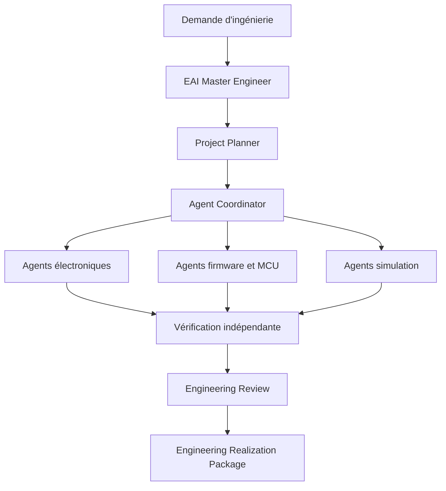
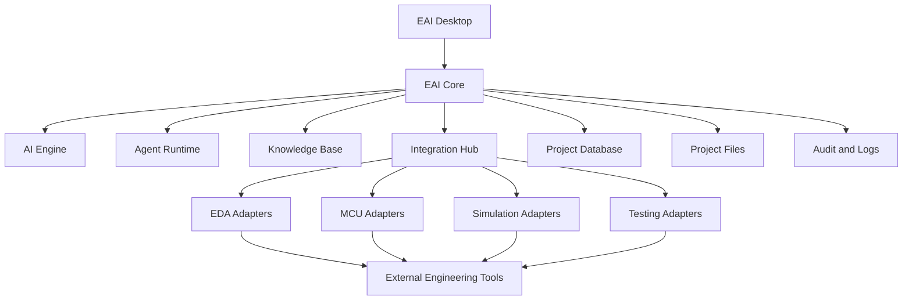
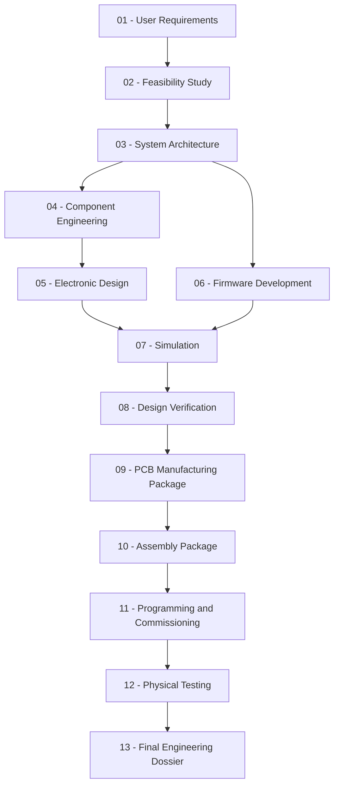
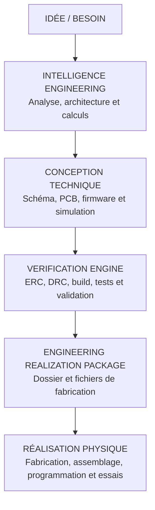

# EMBEDDED AI ENGINEER — DOSSIER STRATÉGIQUE V1.0

**Identifiant :** EAI-STR-001  
**Version :** 1.0  
**Statut :** Document stratégique de référence  
**Plateforme :** Desktop Windows  
**Exécution IA :** Locale  
**Architecture :** Modulaire  
**Autonomie :** Autonomous Engineering  
**Périmètre :** Ingénierie électronique et systèmes embarqués, de l'expression du besoin au dossier de réalisation physique.

---

## Préambule — Notre ambition

EMBEDDED AI ENGINEER (EAI) est un programme de développement logiciel destiné à créer une plateforme d'ingénierie électronique et de systèmes embarqués assistée par intelligence artificielle locale.

Sa finalité dépasse la génération de textes, de schémas théoriques ou de fragments de code. EAI doit transformer une idée, un besoin ou un cahier des charges en un **dossier technique complet, vérifiable et exploitable pour préparer la réalisation physique d'un produit électronique**.

La chaîne d'ingénierie visée comprend :

- Analyse du besoin et définition des exigences.
- Étude de faisabilité et architecture système.
- Calculs et sélection justifiée des composants.
- Conception des schémas électroniques.
- Conception et routage des circuits imprimés (PCB).
- Développement et compilation des firmwares.
- Simulation des circuits, du firmware et des sous-systèmes compatibles.
- Vérification et validation de conception.
- Préparation des fichiers de fabrication et d'assemblage.
- Documentation de programmation, mise en service et maintenance.

EAI devra produire des fichiers techniques natifs et éditables, et pas uniquement des représentations PDF. Les preuves de conception, les hypothèses, les limites et les vérifications restantes devront être explicitement documentées.

# CHAPITRE A — IDENTITÉ ET POSITIONNEMENT STRATÉGIQUE

## A.1. Identité

- **Nom :** EMBEDDED AI ENGINEER
- **Acronyme :** EAI
- **Domaine :** Artificial Intelligence for Electronics and Embedded Systems Engineering
- **Nature :** Plateforme logicielle d'ingénierie assistée et autonome
- **Modèle d'exploitation :** Application Desktop locale, modulaire et extensible

## A.2. Mission principale

Développer un système d'intelligence artificielle capable de concevoir et de préparer des systèmes électroniques et embarqués complets, depuis le cahier des charges jusqu'au dossier de réalisation physique.

## A.3. Vision à long terme

Faire d'EAI une plateforme d'ingénierie capable de prendre en charge plusieurs disciplines, familles de composants, environnements de développement et outils industriels, sans dépendre d'un fournisseur unique.

Les domaines visés comprennent notamment :

1. Électronique analogique et numérique.
2. Systèmes à microcontrôleurs.
3. Électronique de puissance.
4. Systèmes RF et télécommunications.
5. Traitement numérique du signal.
6. Instrumentation et acquisition.
7. Commande de moteurs.
8. Systèmes embarqués avancés.
9. Intégration électronique, logicielle et mécanique.

## A.4. Positionnement

EAI se positionne comme une plateforme d'orchestration et d'ingénierie située entre les logiciels EDA, les environnements de développement embarqué, les simulateurs, les bases documentaires et les modèles d'intelligence artificielle.

EAI ne doit pas nécessairement remplacer KiCad, STM32CubeIDE ou Renode. Il les utilise comme outils spécialisés tout en conservant son propre moteur de raisonnement, de planification, de gestion de projet, de traçabilité et de validation.

# CHAPITRE B — OBJECTIF INDUSTRIEL ET LIVRABLES PHYSIQUES

## B.1. Objectif fondamental

Le résultat final d'un projet EAI est un **Engineering Realization Package (ERP)** : un dossier structuré qui rassemble les éléments nécessaires pour faire fabriquer, assembler, programmer et tester le produit conçu.

## B.2. Composition du dossier de réalisation

| Domaine | Livrables attendus | Formats indicatifs |
|---|---|---|
| Exigences | Cahier des charges, exigences, contraintes | PDF, Markdown, JSON |
| Architecture | Diagrammes fonctionnels, interfaces, budgets | SVG, PDF, sources éditables |
| Schémas | Projet électronique natif, schémas imprimables | KiCad natif, PDF |
| PCB | Projet PCB natif, règles, stackup, modèles 3D | Formats EDA natifs |
| Fabrication PCB | Gerber, perçages, notes de fabrication | Gerber RS-274X/X2, Excellon |
| Approvisionnement | BOM, références, alternatives, statut de qualification | CSV, XLSX |
| Assemblage | Pick-and-Place, dessins, instructions | CSV et PDF |
| Firmware | Sources, configuration, scripts de build et tests | C, C++, Python, fichiers natifs |
| Binaires | Images compilées et symboles de débogage | ELF, HEX, BIN selon cible |
| Simulation | Modèles, paramètres, scripts et résultats | Formats natifs des simulateurs |
| Vérification | Plan de tests, rapports, anomalies, preuves | PDF, Markdown, CSV |
| Mise en service | Programmation, contrôles et procédures | PDF, Markdown |
| Livraison | Arborescence complète, manifeste et versions | Dossier et archive |

Les formats exacts dépendentront du fabricant, du logiciel EDA, du MCU et du processus d'assemblage retenus.

**Exigence majeure :** les livrables doivent rester éditables dans leurs logiciels d'origine. Un PDF de schéma ne remplace pas le projet EDA natif.

## B.3. Niveaux de maturité des projets

| Niveau | Désignation | Signification |
|---|---|---|
| L0 | Concept | Besoin et idée initiale |
| L1 | Architecture | Architecture fonctionnelle et technique |
| L2 | Engineering Design | Conception détaillée et schémas |
| L3 | Simulation Verified | Simulations exécutées et analysées |
| L4 | Design Verified | Vérifications de conception documentées |
| L5 | Manufacturing Ready | Dossier de fabrication contrôlé et complet |
| L6 | Prototype Validated | Prototype physique assemblé et testé |
| L7 | Production Qualified | Processus de production qualifié |

Un dossier L5 ne prouve pas à lui seul que le prototype fonctionne. Les niveaux L6 et L7 nécessitent des preuves issues d'essais physiques et de processus réels.

# CHAPITRE C — PÉRIMÈTRE SCIENTIFIQUE ET TECHNOLOGIQUE

## C.1. Domaines couverts

| ID | Domaine | Périmètre indicatif |
|---|---|---|
| EAI-D01 | Analog Electronics | Amplificateurs, filtres, alimentations |
| EAI-D02 | Digital Electronics | Logique, interfaces, FPGA |
| EAI-D03 | Embedded Systems | MCU, firmware, RTOS |
| EAI-D04 | Power Electronics | Convertisseurs, drivers, protections |
| EAI-D05 | RF Engineering | RF, antennes, filtres, adaptation |
| EAI-D06 | Signal Processing | DSP et traitement du signal |
| EAI-D07 | Communication Systems | CAN, Ethernet, USB, radio |
| EAI-D08 | Sensors & Instrumentation | Acquisition, mesure et capteurs |
| EAI-D09 | Motor Control | BLDC, PMSM et commande moteur |
| EAI-D10 | Hardware Security | Sécurité matérielle et firmware |
| EAI-D11 | FPGA Engineering | HDL et vérification logique |
| EAI-D12 | PCB Engineering | Conception et fabrication PCB |
| EAI-D13 | Thermal Engineering | Analyse thermique électronique |
| EAI-D14 | System Integration | Intégration matérielle et logicielle |

Chaque domaine disposera progressivement de ses agents, Skills, bibliothèques documentaires, outils de calcul, simulateurs et procédures de validation.

## C.2. Types de produits électroniques

EAI devra pouvoir préparer la conception de :

- Cartes de contrôle et d'acquisition.
- Cartes de communication et interfaces.
- Cartes de puissance et de commande moteur.
- Instruments électroniques et systèmes de mesure.
- Équipements RF et télécommunications.
- Modules IoT et systèmes connectés.
- Systèmes embarqués industriels et automobiles.
- Équipements électroniques spécialisés.

## C.3. Ingénierie des composants

Le choix des composants devra être fondé sur des données techniques vérifiables. Les critères incluront :

- Caractéristiques électriques et limites absolues.
- Conditions de fonctionnement recommandées.
- Température et dissipation thermique.
- Boîtier, empreinte et disponibilité des modèles.
- Compatibilité électrique, logique et mécanique.
- Disponibilité commerciale et cycle de vie.
- Prix indicatif et alternatives possibles.
- Disponibilité des modèles de simulation et outils logiciels.

EAI devra distinguer clairement les données constructeur, les données distributeur, les estimations et les hypothèses. Une référence de composant ne sera pas déclarée qualifiée sans vérification de sa documentation et de sa disponibilité.

## C.4. Intégration mécanique associée

Le périmètre pourra intégrer les interfaces mécaniques nécessaires :

- Dimensions et fixations des cartes.
- Connecteurs et dégagements.
- Boîtiers et enveloppes.
- Dissipateurs et interfaces thermiques.
- Contraintes d'assemblage et de maintenance.
- Modèles 3D de composants.

Une intégration FreeCAD pourra être ajoutée dans une phase ultérieure.

# CHAPITRE D — ARCHITECTURE INTELLIGENTE ET MULTI-AGENTS

## D.1. Principe général

EAI reposera sur une intelligence artificielle locale orchestrant des agents spécialisés. L'utilisateur formule le besoin ; EAI l'analyse, planifie le projet, répartit les tâches, exécute les outils appropriés, vérifie les résultats et assemble les livrables.



## D.2. Registre initial des agents

| ID | Agent | Fonction |
|---|---|---|
| AG-001 | Master Engineer | Direction et coordination du projet |
| AG-002 | Requirements Engineer | Analyse et traçabilité des exigences |
| AG-003 | System Architect | Architecture globale |
| AG-004 | Electronics Engineer | Conception électronique |
| AG-005 | Component Engineer | Sélection et qualification des composants |
| AG-006 | Schematic Engineer | Création et contrôle des schémas |
| AG-007 | PCB Engineer | Placement, routage et contrôles PCB |
| AG-008 | MCU Engineer | Choix et configuration des MCU |
| AG-009 | Firmware Engineer | Développement firmware |
| AG-010 | RTOS Engineer | Systèmes temps réel |
| AG-011 | Power Engineer | Électronique de puissance |
| AG-012 | RF Engineer | Systèmes radio |
| AG-013 | Simulation Engineer | Modèles et simulations |
| AG-014 | Test Engineer | Plans et exécution des tests |
| AG-015 | Verification Engineer | Vérification indépendante |
| AG-016 | Manufacturing Engineer | Préparation à la fabrication |
| AG-017 | Documentation Engineer | Documentation et dossier final |

Les agents pourront être subdivisés en sous-agents spécialisés. Leur nombre et leur modèle IA ne seront pas figés dans le cœur du système.

## D.3. Intelligence distribuée

Le Model Manager sélectionnera le modèle ou l'outil selon :

- La nature et la complexité de la tâche.
- Le domaine technique.
- Les capacités du modèle.
- Les ressources matérielles disponibles.
- Les exigences de précision et de traçabilité.

| Opération | Moteur privilégié |
|---|---|
| Compréhension du besoin | LLM généraliste |
| Analyse et génération de code | Coding LLM |
| Lecture de documents et schémas | OCR, vision et RAG |
| Calculs numériques | Python, NumPy, SciPy |
| Optimisation | Méthodes numériques, ML ou RL selon le problème |
| Simulation électrique | Simulateur SPICE |
| Vérification logicielle | Compilateurs, analyseurs et tests |

Le ML, le DL et le RL sont des capacités complémentaires. Le RL sera utilisé lorsque le problème dispose d'un environnement, d'actions et d'une fonction de récompense adaptés ; il ne remplace pas les méthodes déterministes de vérification.

## D.4. Autonomie opérationnelle

Le cycle de travail automatisé comprendra :

1. Analyse.
2. Planification.
3. Exécution.
4. Vérification.
5. Correction.
6. Réexécution.
7. Consolidation.
8. Livraison.

Les corrections automatiques devront être limitées aux opérations comprises, traçables et réversibles. Les actions ayant un impact physique ou financier — programmation d'un équipement réel, activation d'une puissance, commande d'un moteur, fabrication ou achat — nécessiteront une autorisation explicite.

# CHAPITRE E — ARCHITECTURE LOGICIELLE ET INFRASTRUCTURE

## E.1. Architecture générale

EAI sera une application Desktop Windows, modulaire et locale. Les modules communiqueront par des interfaces documentées et ne dépendront pas directement de l'interface graphique.



## E.2. Technologies de référence

| Couche | Technologie envisagée |
|---|---|
| OS initial | Windows Desktop |
| Langage principal | Python 3.12+ |
| Interface Desktop | PyQt6 |
| Backend interne | Python |
| API locale éventuelle | FastAPI |
| Exécution asynchrone | asyncio |
| IA locale | llama.cpp et/ou LM Studio |
| ML / DL | PyTorch, scikit-learn |
| RAG | FAISS et/ou Chroma |
| Base de données | SQLite |
| Versioning | Git |
| Build C/C++ | GCC, CMake, Ninja |
| Debug MCU | GDB et outils constructeur |
| Intégration | API, CLI, MCP selon disponibilité |
| Tests | pytest |

Ces technologies constituent une base de référence et pourront évoluer après des essais de compatibilité, de performance et de licence.

## E.3. Organisation du dépôt

```text
EMBEDDED_AI_ENGINEER/
├── README.md
├── LICENSE
├── CHANGELOG.md
├── pyproject.toml
├── app/
├── core/
│   ├── orchestrator/
│   ├── workflows/
│   ├── tasks/
│   ├── projects/
│   ├── resources/
│   ├── state/
│   └── audit/
├── ai/
│   ├── runtime/
│   ├── models/
│   ├── agents/
│   ├── rag/
│   ├── ml/
│   ├── dl/
│   └── rl/
├── engineering/
│   ├── requirements/
│   ├── architecture/
│   ├── electronics/
│   ├── eda/
│   ├── mcu/
│   ├── firmware/
│   ├── simulation/
│   ├── testing/
│   └── manufacturing/
├── integrations/
│   ├── mcp/
│   ├── api/
│   ├── cli/
│   └── adapters/
├── plugins/
├── knowledge/
├── skills/
├── desktop/
├── database/
├── projects/
├── tests/
├── tools/
├── scripts/
└── docs/
```

## E.4. Gestion des plugins

Chaque outil externe sera intégré par un adaptateur dédié, avec une interface et des capacités déclarées.

| ID | Adaptateur | Outil cible |
|---|---|---|
| PLG-EDA-001 | KiCad Adapter | KiCad 9+ |
| PLG-MCU-001 | STM32 Configuration Adapter | STM32CubeMX |
| PLG-MCU-002 | STM32 IDE Adapter | STM32CubeIDE |
| PLG-SIM-001 | MCU Simulator Adapter | Renode |
| PLG-SIM-002 | Analog Simulator Adapter | ngspice |
| PLG-SIM-003 | Digital Simulator Adapter | Verilator |
| PLG-SIM-004 | RF Simulator Adapter | Qucs-S |
| PLG-SIM-005 | EM Simulator Adapter | openEMS |
| PLG-SIM-006 | SDR Adapter | GNU Radio |

Les intégrations OrCAD, Altium Designer, EAGLE et d'autres outils seront ajoutées progressivement, sous réserve de leurs interfaces, licences et possibilités d'automatisation.

## E.5. Architecture des Skills

Chaque Skill est une unité indépendante de connaissance et de procédure technique. Elle indique aux agents comment accomplir une tâche, quels outils employer, quelles contraintes respecter et comment vérifier le résultat.

Exemple :

```text
skills/
└── stm32/
    └── stm32g4/
        ├── SKILL.md
        ├── references/
        │   ├── datasheets/
        │   ├── reference_manuals/
        │   └── application_notes/
        ├── procedures/
        ├── examples/
        ├── scripts/
        ├── templates/
        └── validation/
```

Les Skills doivent être versionnés et liés aux versions de composants, SDK et outils auxquelles ils s'appliquent.

# CHAPITRE F — ENVIRONNEMENTS EDA, MCU ET SIMULATION

## F.1. EAI-EDA

Le premier environnement EDA sera KiCad 9 minimum.

Fonctions visées :

- Création et gestion de projets.
- Création et modification de schémas.
- Gestion des bibliothèques de symboles et empreintes.
- Vérification ERC.
- Conception PCB et règles de conception.
- Placement et routage.
- Vérification DRC.
- BOM et fichiers d'assemblage.
- Gerber, perçages et documentation.
- Modèles 3D et contrôles mécaniques de base.

Une représentation intermédiaire indépendante, **EAI-IR (Engineering Intermediate Representation)**, devra être étudiée pour représenter les composants, nets, broches, contraintes et interfaces sans dépendre d'un seul outil EDA.

## F.2. EAI-MCU

La première famille de référence sera STM32.

| Constructeur | Familles envisagées | Environnements à étudier |
|---|---|---|
| STMicroelectronics | STM32 | STM32CubeMX, STM32CubeIDE, HAL, LL |
| Texas Instruments | MSP430, MSPM0, C2000 | Outils et SDK TI |
| NXP | LPC, i.MX RT, S32K | MCUXpresso et outils associés |
| Infineon | XMC, AURIX, PSoC | ModusToolbox et outils associés |

L'architecture devra gérer les différences de CPU, périphériques, SDK, compilateurs, débogueurs, outils de programmation et licences. Les familles seront intégrées selon un ordre de priorité défini par les projets pilotes.

## F.3. EAI-SIM

| Sous-module | Domaine | Moteur envisagé |
|---|---|---|
| SIM-MCU | Microcontrôleurs | Renode |
| SIM-ANA | Analogique | ngspice |
| SIM-DIG | Logique numérique | Verilator, Icarus Verilog |
| SIM-RF | RF et circuits associés | Qucs-S |
| SIM-EM | Électromagnétisme | openEMS |
| SIM-DSP | Traitement du signal | GNU Radio, Python |

La prise en charge dépendra des modèles disponibles, de la compatibilité de la cible et des capacités réelles de chaque simulateur. Une simulation MCU ne constitue pas une preuve de fonctionnement électrique complet de la carte.

## F.4. Co-simulation

EAI devra évoluer vers la combinaison de plusieurs simulations, par exemple :

- Firmware exécuté dans un simulateur MCU compatible.
- Circuit analogique simulé dans ngspice.
- Logique numérique vérifiée avec un simulateur HDL.
- Signaux et résultats échangés par des interfaces documentées.

La co-simulation ne sera déclarée opérationnelle qu'après implémentation et validation des mécanismes d'échange, de synchronisation et de reproductibilité entre moteurs.

# CHAPITRE G — PROCESSUS INDUSTRIEL DE RÉALISATION

## G.1. Cycle complet d'un projet



## G.2. Étape 1 — Analyse des besoins

EAI transforme la demande en exigences techniques mesurables. Pour un contrôleur BLDC, par exemple, il devra identifier :

- Type et caractéristiques du moteur.
- Tension, courant et puissance.
- Type de commande et plage de fonctionnement.
- Capteurs et interfaces.
- Contraintes thermiques et mécaniques.
- Conditions d'environnement.
- Protections et exigences de sécurité.
- Objectifs de performance et critères d'acceptation.

Les informations manquantes seront signalées. Les hypothèses ne devront jamais être présentées comme des exigences confirmées.

## G.3. Étape 2 — Architecture

Livrables :

- Architecture fonctionnelle et électronique.
- Architecture firmware.
- Diagrammes de blocs.
- Définition des interfaces.
- Budgets énergétiques et contraintes.
- Liste préliminaire des composants.
- Analyse des risques techniques.

## G.4. Étape 3 — Conception électronique

EAI réalise les calculs, sélectionne les composants, prépare le schéma, vérifie les connexions et transfère les données vers l'outil EDA. Les résultats et les sources de justification sont conservés dans le projet.

## G.5. Étape 4 — Développement firmware

Livrables possibles :

- Configuration MCU et horloges.
- Drivers et middleware.
- Firmware applicatif.
- Gestion des erreurs et diagnostics.
- Interfaces de communication.
- Tests unitaires et d'intégration.
- Scripts de compilation et de programmation.
- Fichiers compilés et symboles de débogage.

Le code doit être compilé avec la chaîne d'outils appropriée. Une compilation réussie ne prouve pas à elle seule le fonctionnement sur le matériel réel.

## G.6. Étape 5 — Simulation et vérification

Les simulateurs exécutent les analyses compatibles avec leurs modèles. Les résultats sont comparés aux exigences et leurs limites sont documentées.

## G.7. Étape 6 — Préparation de fabrication

Le Manufacturing Engineer prépare :

- Gerber et fichiers de perçage.
- BOM avec références et statuts de qualification.
- Pick-and-Place.
- Dessins d'assemblage.
- Stackup et notes de fabrication.
- Instructions d'assemblage et points de contrôle.
- Liste des éléments à confirmer auprès du fabricant.

Les fichiers doivent être contrôlés avant livraison et associés à la révision exacte du PCB.

## G.8. Étape 7 — Mise en service et essais physiques

EAI prépare les procédures pour programmer le MCU, contrôler les alimentations, vérifier les interfaces et exécuter les tests fonctionnels. Les mesures réelles, instruments, conditions d'essai, résultats et anomalies doivent être consignés.

La validation physique ne peut être déclarée réussie que sur la base de résultats expérimentaux documentés.

# CHAPITRE H — QUALITÉ, VALIDATION ET FIABILITÉ

## H.1. Principe de qualité

La vérification doit être indépendante de la génération. Un agent concepteur ne peut pas être l'unique autorité qui valide sa propre conception. Le Verification Engineer applique des critères indépendants et exige des preuves.

## H.2. Classification des preuves

| Niveau | Type de preuve | Exemple |
|---|---|---|
| EV0 | Hypothèse | Proposition non vérifiée du modèle |
| EV1 | Référence documentaire | Datasheet ou manuel constructeur |
| EV2 | Calcul vérifiable | Calcul électrique ou thermique documenté |
| EV3 | Contrôle automatique | ERC, DRC, analyse statique |
| EV4 | Simulation exécutée | Résultat associé à un modèle et à des paramètres |
| EV5 | Test logiciel ou matériel | Test reproductible avec journal |
| EV6 | Validation expérimentale | Essai physique avec mesures documentées |

Le niveau de preuve doit être associé aux affirmations et décisions techniques importantes.

## H.3. Statuts des tâches et livrables

- `NOT_STARTED`
- `IN_PROGRESS`
- `GENERATED`
- `BUILD_PASSED`
- `SIMULATION_PASSED`
- `VERIFIED`
- `BLOCKED`
- `FAILED`
- `REQUIRES_PHYSICAL_TEST`

Un Gerber généré n'est pas automatiquement un PCB validé. Un firmware compilé n'est pas automatiquement un firmware fonctionnel sur la carte réelle.

## H.4. Contrôles de fabrication et de sécurité

Les contrôles comprennent notamment :

- Vérification des fichiers de fabrication et de leur révision.
- Vérification des empreintes, polarités et références.
- Contrôle des espacements et contraintes de fabrication.
- Contrôle des capacités thermiques et électriques.
- Vérification des interfaces et connecteurs.
- Vérification de la BOM et des substitutions.
- Contrôle de l'assemblage et de la testabilité.

Pour les produits soumis à des exigences réglementaires ou de sécurité, EAI devra identifier les normes applicables et préparer les éléments de conformité. Il ne devra jamais déclarer une certification qui n'a pas été obtenue.

# CHAPITRE I — STRATÉGIE DE DÉVELOPPEMENT ET ÉVOLUTION

## I.1. Développement progressif

| Phase | Programme | Résultat principal |
|---|---|---|
| P0 | EAI Foundation | Core, Desktop, gestion de projet, base de données, plugins |
| P1 | EAI Intelligence | LLM local, Model Manager, agents, RAG, Skills |
| P2 | EAI Electronic Design | KiCad, composants, schémas, ERC, PCB, DRC |
| P3 | EAI Embedded | STM32CubeMX, STM32CubeIDE, firmware, compilation |
| P4 | EAI Simulation | Renode, ngspice, logique numérique et RF |
| P5 | EAI Manufacturing | BOM, Gerber, Pick-and-Place et dossier de fabrication |
| P6 | Multi-Vendor Expansion | TI, NXP, Infineon, autres constructeurs, OrCAD et Altium |
| P7 | Advanced AI Engineering | ML, DL, RL, optimisation et co-simulation |

Chaque phase doit avoir des critères d'acceptation, des tests reproductibles et des livrables démontrables avant d'être considérée comme achevée.

## I.2. Projet pilote

Le premier projet de validation de bout en bout sera une carte électronique basse tension basée sur un STM32G474.

| Élément | Livrable attendu |
|---|---|
| Cahier des charges | Spécification et critères d'acceptation |
| Architecture | Diagrammes et interfaces |
| MCU | STM32G474, référence exacte à sélectionner |
| Schéma | Projet KiCad natif |
| PCB | Projet PCB éditable |
| Firmware | Code source et configuration |
| Build | Résultat de compilation et fichiers associés |
| Simulation | Modèles et résultats compatibles |
| Tests | Plan, scripts et rapports |
| Fabrication | Gerber, BOM et Pick-and-Place |
| Documentation | Dossier de réalisation |

Ce projet pilote doit valider la chaîne logicielle avant toute connexion à des équipements de puissance.

## I.3. Indicateurs de performance

| KPI | Indicateur |
|---|---|
| K1 | Pourcentage d'exigences tracées vers des livrables et tests |
| K2 | Pourcentage de tâches automatisées avec résultat vérifié |
| K3 | Taux de compilation réussie sur les projets pris en charge |
| K4 | Taux de simulations exécutées sans erreur technique |
| K5 | Défauts détectés avant fabrication |
| K6 | Complétude du dossier de réalisation |
| K7 | Reproductibilité des livrables |
| K8 | Nombre de familles MCU intégrées et testées |
| K9 | Nombre d'outils EDA intégrés et testés |
| K10 | Taux de validation des prototypes physiques |

Les objectifs numériques seront définis après établissement d'une mesure de référence. Aucun taux de réussite ne doit être annoncé sans campagne de tests.

# CHAPITRE J — GOUVERNANCE, PROPRIÉTÉ ET PÉRENNITÉ

## J.1. Indépendance technologique

EAI doit préserver son indépendance vis-à-vis :

- Des fabricants de microcontrôleurs.
- Des fournisseurs de logiciels EDA.
- Des fournisseurs de modèles IA.
- Des fournisseurs de simulateurs.
- Des fournisseurs de bibliothèques de composants.

Les adaptateurs doivent être remplaçables sans modification majeure du cœur. Les formats intermédiaires et les données de projet doivent limiter le verrouillage fournisseur.

## J.2. Gestion des licences

Le programme doit maintenir un registre des licences et conditions d'utilisation, en distinguant :

- Logiciels open source.
- Logiciels commerciaux.
- Bibliothèques propriétaires.
- SDK constructeurs.
- Modèles IA et leurs licences.
- Documentation et bases de données.
- Fichiers générés.

EAI ne doit pas redistribuer un logiciel, une bibliothèque, un modèle ou une documentation lorsque sa licence ne l'autorise pas.

## J.3. Propriété intellectuelle

Les éléments propres au programme comprennent notamment :

- Code source EAI.
- Architecture logicielle.
- Agents et orchestrateur.
- Skills développés en interne.
- Formats intermédiaires.
- Workflows.
- Méthodes de vérification.
- Bibliothèques et modèles développés en interne.

Les composants tiers restent soumis à leurs licences et conditions respectives.

## J.4. Gouvernance technique

Le programme maintiendra :

1. Document stratégique maître.
2. Cahier des charges logiciel.
3. Architecture technique.
4. Registre des modules.
5. Registre des plugins.
6. Registre des Skills.
7. Registre des exigences.
8. Registre des tests et preuves.
9. Historique des versions.
10. Registre des décisions d'ingénierie.

Toute modification majeure de l'architecture sera documentée et associée à une décision de conception.

# CHAPITRE K — OBJECTIF FINAL ET CRITÈRES DE RÉUSSITE

## K.1. Chaîne de transformation cible



## K.2. Critères de succès stratégique

EAI aura atteint son objectif stratégique lorsqu'il pourra prendre en charge un projet suffisamment spécifié et produire, avec une intervention humaine limitée et traçable :

- Un cahier des charges technique.
- Une architecture système.
- Une sélection justifiée des composants.
- Un schéma électronique natif.
- Un PCB natif.
- Les fichiers de fabrication.
- Un firmware compilable.
- Les fichiers de configuration MCU.
- Les modèles et résultats de simulation disponibles.
- Les rapports de vérification.
- Les instructions d'assemblage.
- Les instructions de programmation et de mise en service.
- Un dossier complet et versionné de réalisation.

La validation physique finale restera une étape distincte, reposant sur des mesures et essais réels.

## K.3. Ambition à long terme

EAI ne vise pas seulement à automatiser la programmation des microcontrôleurs. Il vise à prendre en charge l'ensemble du processus d'ingénierie électronique, de la spécification à la préparation de la fabrication, en intégrant les outils et disciplines nécessaires.

Les projets cibles pourront inclure des contrôleurs industriels, des cartes de commande moteur BLDC, des systèmes multicapteurs, des équipements de télécommunication, des instruments de mesure, des systèmes de gestion énergétique, des cartes RF et des produits électroniques spécialisés.

# ANNEXE A — REGISTRE DES MODULES OFFICIELS

| Identifiant | Module | Priorité initiale |
|---|---|---|
| EAI-CORE-001 | Core Engineering Engine | P0 |
| EAI-AI-001 | Artificial Intelligence Engine | P0 |
| EAI-AGT-001 | Multi-Agent System | P1 |
| EAI-KB-001 | Engineering Knowledge Base | P1 |
| EAI-EDA-001 | Electronic Design Automation | P2 |
| EAI-MCU-001 | MCU Engineering | P3 |
| EAI-FW-001 | Firmware Engineering | P3 |
| EAI-SIM-001 | Simulation Engineering | P4 |
| EAI-TEST-001 | Verification & Testing | P4 |
| EAI-MFG-001 | Manufacturing Engineering | P5 |
| EAI-DOC-001 | Documentation Engineering | P5 |
| EAI-INT-001 | Integration Hub | P0 |
| EAI-GOV-001 | Governance & Quality | P0 |

# ANNEXE B — PREMIER LIVRABLE DE DÉVELOPPEMENT

## EAI FOUNDATION v0.1

**Mission :** construire le noyau logiciel fonctionnel sur lequel reposera le programme.

### Fonctions obligatoires

- Application Desktop PyQt6.
- EAI Core.
- Project Manager.
- Database Manager.
- Plugin Manager initial.
- Local AI Model Manager.
- Connexion à un runtime IA local.
- Agent Runtime initial.
- Task Manager.
- Logging et audit.
- Gestion des ressources locales.

### Critère de sortie

EAI doit pouvoir recevoir une demande technique, créer un projet, interroger un modèle IA local, créer une tâche, exécuter un outil de test contrôlé et enregistrer les résultats dans le projet. Le fonctionnement de base doit être démontré sans connexion Internet après installation des dépendances nécessaires.

# ANNEXE C — DOCUMENTS DE RÉFÉRENCE À DÉVELOPPER

| ID | Document |
|---|---|
| EAI-SRS-001 | Software Requirements Specification |
| EAI-SAD-001 | Software Architecture Document |
| EAI-API-001 | Internal API Specification |
| EAI-PLG-001 | Plugin Development Specification |
| EAI-AI-001 | AI & Agent Engineering Specification |
| EAI-EDA-001 | EDA Integration Specification |
| EAI-MCU-001 | MCU Engineering Specification |
| EAI-SIM-001 | Simulation Framework Specification |
| EAI-QA-001 | Quality Assurance Plan |
| EAI-MFG-001 | Manufacturing Output Specification |
| EAI-SEC-001 | Security & Local Execution Specification |
| EAI-TEST-001 | Verification & Validation Plan |

# CONCLUSION STRATÉGIQUE

**EMBEDDED AI ENGINEER ne doit pas être conçu comme un simple générateur de code électronique, mais comme un système complet d'ingénierie capable de produire des dossiers techniques destinés à la réalisation physique de produits électroniques.**

Sa valeur repose sur l'intégration cohérente de :

- L'intelligence artificielle locale.
- L'ingénierie électronique.
- La conception PCB.
- Le développement firmware.
- Les microcontrôleurs multi-constructeurs.
- Les simulateurs spécialisés.
- La vérification automatisée.
- La documentation technique.
- La préparation à la fabrication.

La plateforme doit coordonner les agents et les outils, détecter les erreurs, conserver les preuves et produire des livrables traçables. Elle doit également distinguer sans ambiguïté les résultats générés, compilés, simulés, vérifiés et validés physiquement.

> **Règle directrice du programme : EAI transforme une spécification technique en une conception électronique documentée, vérifiée et préparée pour sa réalisation physique.**

---

## Contrôle documentaire

| Champ | Valeur |
|---|---|
| Document | EAI-STR-001 |
| Titre | Dossier stratégique EMBEDDED AI ENGINEER |
| Version | 1.0 |
| Statut | Référence stratégique initiale |
| Périmètre | Vision, architecture et stratégie industrielle |
| Document opérationnel suivant | EAI-SRS-001 |

**Règle de gouvernance :** EAI-STR-001 est le document maître stratégique. Les spécifications détaillées, modules, interfaces et développements doivent rester cohérents avec ses objectifs. Toute évolution majeure doit être enregistrée dans l'historique des décisions et versions.
